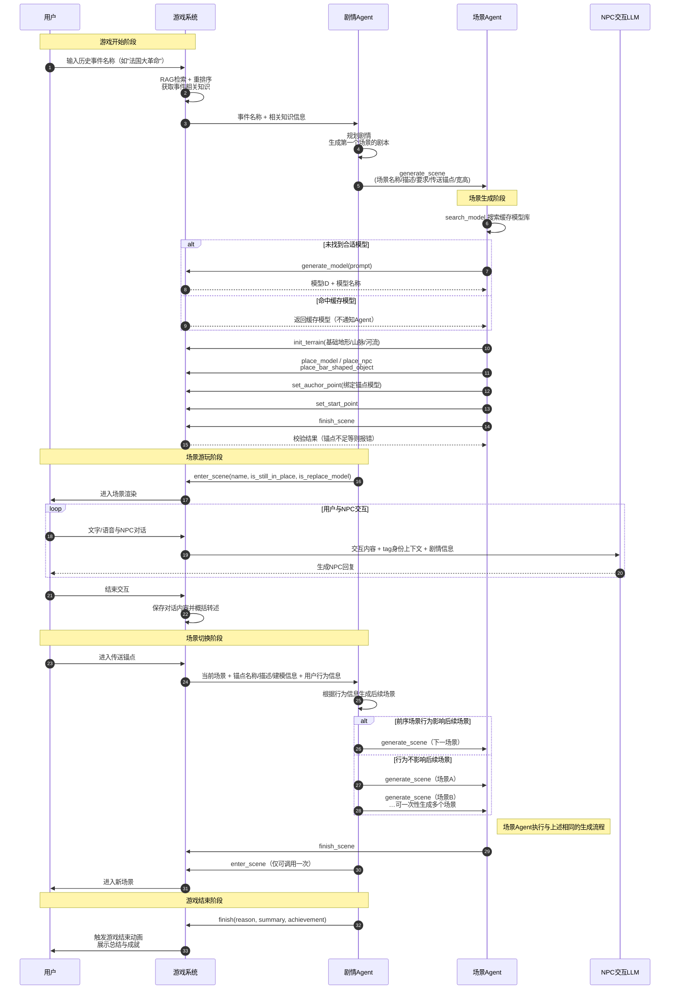

# EpicSpark 架构文档

## 0. 简介

EpicSpark是一个用Unity引擎开发的，AI驱动的游戏化的历史教学软件。用于让用户体验历史，感受历史的发展潮流。

## 1. 平台

本游戏是一个跨平台单机游戏，主要支持Windows和Android平台。

AI部分，采用外接OpenAI API兼容端点（主要为ai.gitee.com）提供的模型。用户需自备API Key。

特别的，对于Android平台，还另外支持使用VR盒子（CardBoard类型设备）进行沉浸式体验。在VR模式下，还另外支持将游戏画面，通过一定的协议，传送至显示屏中（即展示模式），以供多人观看。接收画面的显示屏端，需要运行一个专门的接收程序。该程序将令建仓库处理。

## 2. 技术栈

Unity引擎使用2022.3版本，采用3D。编程语言为C#。

## 3. VR与摄像头实现

在同一高度下，分别放置左中右三个摄像头，用于VR模式下的左右眼视角。在VR模式下，将自动切换至VR模式的左右摄像头，对应左右眼。在非VR模式下，将自动切换至中摄像头，对应主视角。

VR模式下的展示模式，同步的是中摄像头的画面。

手机的陀螺仪数据，用于视角旋转。在VR模式下，将自动启用陀螺仪控制。在非VR模式下，将自动关闭陀螺仪控制。允许用户调节其灵敏度。

## 4. 剧情与场景

游戏允许用户自由输入一个历史事件，例如“山顶洞人”“法国大革命”等，然后AI会驱动游戏，帮助用户理解该历史事件的背景、过程和影响等。

在这个过程中，有两个AI Agent参与：

- 剧情Agent
- 场景Agent

剧情Agent会在用户输入后，生成第一个场景的表述、剧本等，并根据用户后续在场景内的操作，串行的生成后续场景。场景Agent会根据剧情Agent生成的剧本，生成对应的场景。

所有Agent与游戏的主动交互都通过工具（Function Call或Tool Call）进行。

### 4.1 剧情Agent

剧情Agent有如下工具：

- `generate_scene`：生成场景
- `enter_scene`：进入场景。在用户进入传送锚点出场景后，会唤醒剧情Agent，直到剧情Agent调用此工具，用户会进入指定的场景。
- `finish`: 结束游戏。当剧情Agent认为游戏已经结束时，调用此工具。该工具将触发游戏结束动画等。

`generate_scene`的输入参数为：

- `scene_name` string：场景名称
- `scene_description` string：场景描述
- `requirement` string：场景要求。用于给场景Agent提供要求。要求不仅包括地形、模型等要求，还包括NPC要求。
- `transmission_auchor_points` array of object：传送锚点，用于玩家的传送。
- `width` number：场景宽度。这个宽度将被系统直接限制。
- `length` number：场景长度。这个长度将被系统直接限制。

传送锚点用于用户在不同场景间进行传送。例如从家门口到巴士底狱。另外，时间的跳转同样依靠传送锚点来实现“例如床”。传送锚点在场景中绑定具体建模，例如马车、公交车等，由场景Agent决定，剧情Agent可以提供要求。

剧情Agent调用传送锚点`generate_scene`时，其传送锚点列表元素的结构为：

- `name` string：锚点名称
- `description` string：锚点描述
- `requirement` string：锚点要求。用于给场景Agent提供要求。例如“必须是马车”、“必须是巴士底狱”等。
- `spend_time` string：该锚点影响的游戏时间。例如10d、2h、5min等。只能使用y/d/h/min四个单位，分别代表年、日、小时、分钟。

`enter_scene`的输入参数为：

- `name` string: 要进入的场景名称
- `is_still_in_place` bool: 是否在原地。只有`name`为当前场景的`name`这个参数才有意义。
- `is_replace_model` bool：是否是替换建模。如果为true，则将用户交互的传送锚点位置替换为新的场景模型，实现室内外等效果；当用户离开该场景，进入外界时，将恢复原模型。

`finish`的输入参数为：

- `reason` string: 结束原因。用于游戏结束动画等。
- `summary` string: 游戏总结。用于游戏结束动画等。
- `achievement` string: 成就。用于游戏结束动画和开始页展示等。

剧情Agent在游戏开始时接到如下输入：

- 用户输入的历史事件名称（例如“法国大革命”）
- 该事件的相关知识信息（通过RAG和重排序从知识库中获取）

剧情Agent需要据此生成第一个场景然后进入。

在用户进入某一个传送锚点后，剧情Agent会收到如下输入：

- 当前场景名称
- 用户进入的锚点名称
- 用户进入的锚点描述
- 用户进入的锚点建模信息（例如大小等）
- 用户的行为信息（如用户和NPC的对话信息等）

剧情Agent需要据此生成下一个场景，随后调用`enter_scene`工具。如果剧情Agent认为可以直接生成多个场景，而用户在前序场景的行为不会影响后续场景，则可以一次性调用`generate_scene`工具多次，但只能调用一次`enter_scene`工具，直到用户完成并退出该场景。

### 4.2 场景Agent

在剧情Agent调用`generate_scene`后，场景Agent会收到如下输入：

- 场景描述
- 场景要求
- 传送锚点列表
- 场景大小

场景Agent操作的坐标为平面x, y坐标，而不是Unity以y轴为高的三维坐标。

场景Agent有如下工具（参数列表放在二级列表中）：

- `init_terrain`: 初始化地形
  - `base` string: 基础地形。只能选择`plain`（平原,没有任何高差）
  - `mountains` array of object: 山脉。每个元素为一个山脉对象，包含：
    - `nodes` array of object: 节点列表，每个节点为一个坐标点，格式为`[x, y, height, width]`。场景会对其进行平滑化处理
    - `smoothing_factor` number: 平滑因子。用于控制山脉的平滑程度，范围0-1，越小越平滑。
  - `rivers` array of object: 河流。每个元素为一个河流对象，包含：
    - `nodes` array of object: 节点列表，每个节点为一个坐标点，格式为`[x, y, depth, width]`。场景会对其进行平滑化处理
    - `smoothing_factor` number: 平滑因子。用于控制河流的平滑程度，范围0-1，越小越平滑。

- `place_model`: 放置模型。高度坐标由系统以刚好防止模型穿透地形为原则自动计算。
  - `model_id` string: 模型ID
  - `x` number: X坐标
  - `y` number: Y坐标
  - `placed_name` string: 放置模型实例名称
  - `size_x` number: X轴大小
  - `size_y` number: Y轴大小

- `place_npc`: 放置NPC。高度坐标由系统以刚好防止模型穿透地形为原则自动计算。
  - `person_model_id` string: 人物模型ID
  - `x` number: X坐标
  - `y` number: Y坐标
  - `npc_name` string: NPC名称
  - `tag` string: 标签。用于当LLM介入NPC交互时，提供身份和上下文信息。

- `place_bar_shaped_object`: 放置条状物体。高度坐标由系统以刚好防止模型穿透地形为原则自动计算。
  - `type` string: 物体类型。只能选择`wall`（墙）、`fence`（栅栏）、`road`（道路）、`trench`（战壕）
  - `nodes` array of object: 节点列表，每个节点为一个坐标点，格式为`[x, y, width]`。

- `set_auchor_point`: 设置传送锚点。
  - `auchor_name` string: 锚点名称
  - `placed_name` string: 锚点放置的模型实例名称

- `set_start_point`: 设置玩家起始点。高度坐标由系统以刚好防止模型穿透地形为原则自动计算。
  - `x` number: X坐标
  - `y` number: Y坐标

- `search_model`: 搜索模型。用于在缓存模型库里搜索模型
  - `search_word` string：搜索关键词。如果为空，则返回所有模型列表；如果为关键词，则返回匹配的模型列表。包括ID、名称和生成提示词等信息

- `generate_model`: 生成模型。如果场景Agent无法在缓存模型库里找到合适的模型，则可以调用此工具生成新模型。返回模型ID和模型名称。如果生成失败，会返回错误。
  - `prompt` string: 模型生成提示词

- `finish_scene`: 完成场景生成。在所有场景元素放置完成后，调用此工具。如果场景生成有问题，例如传送锚点不足等，会在此处向LLM报错。

### 4.3 NPC交互

NPC交互由专有的LLM驱动，用于与用户进行对话。该LLM将使用`place_npc`工具提供的`tag`信息、游戏剧情信息等作为上下文，以确保对话的连贯性。

用户可以通过输入文字或语言识别等方式与NPC进行交互。交互内容将被发送给LLM，LLM会根据上下文生成回复。

当用户结束交互时，系统会保存其交互对话内容，并在后续经LLM概括和转述等向剧情Agent汇报。概括和转述的目的是防止LLM出现对话主体的困惑问题。

### 4.4 模型生成与复用

模型生成采用Z-Image-TurBo+RMBG-2.0+Hunyuan3D-2模型的文生图+去背景+图生3D流程，全部调用ai.gitee.com的API。

用户可以设定一个阈值，决定在场景Agent调用`generate_model`工具时，多大程度上使用缓存模型。当Agent调用该工具时，会对其进行词嵌入向量计算，然后与缓存模型库中的词嵌入向量进行夹角余弦相似度比较，如果相似度超过阈值，则使用缓存模型；否则生成新模型。使用缓存模型是不会通知Agent，防止其不断重试生成模型。

### 4.5 典型时序图

## 5. 知识库

知识库采用RAG技术，全部在Unity进程内以C#实现，不依赖独立检索进程或HTTP检索服务。结构化历史事件语料位于`Assets/Resources/Knowledge/Events`，随游戏包发布；向量索引保存在`Application.persistentDataPath`。检索采用向量余弦与BM25双路召回，经RRF融合后重排序，以确保最相关的信息优先呈现给剧情Agent。具体接口见`Docs/KnowledgeRAG.md`。

4.4节和本章提到的词嵌入模型默认采用ai.gitee.com的Qwen3-Embedding-8B模型，重排序模型默认采用ai.gitee.com的Qwen3-Reranker-8B模型。模型端点通过`KnowledgeSettings.baseUrl`配置，可替换为其他OpenAI兼容地址；未配置API Key或远端不可用时，使用Unity内的确定性向量、BM25与本地重排继续工作。
