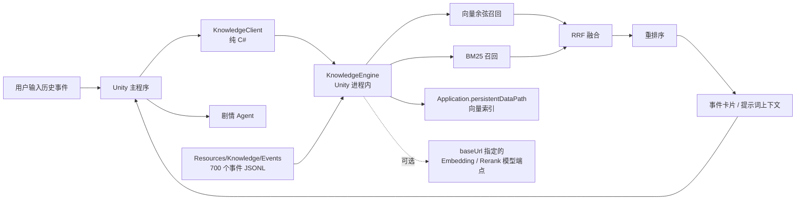

# EpicSpark Unity 知识库与 RAG

> 对应 `ARCHITECT.md` 第 5 章。本文是主程序对接契约。
> **知识库完全运行在 Unity 进程内，不启动 Python、HTTP 检索服务或任何独立进程。**

## 1. 架构



| 决策 | 实现 |
|---|---|
| 运行方式 | Unity 进程内纯 C#，Windows / Android 同一套代码 |
| 语料 | `Assets/Resources/Knowledge/Events/*.txt`，随 Unity 包发布 |
| 检索 | 向量余弦 + BM25 → RRF → 重排 → 相对阈值过滤 |
| 嵌入 | 默认 ai.gitee.com `Qwen3-Embedding-8B`；离线用 Unity 内 SHA-256 特征向量 |
| 重排 | 默认 ai.gitee.com `Qwen3-Reranker-8B`；失败时用 Unity 内词汇重排 |
| 模型地址 | `KnowledgeSettings.baseUrl`，可替换为任意 OpenAI 兼容端点 |
| 索引 | 归一化 float32，保存在 `Application.persistentDataPath/Knowledge/vectors.bin` |
| 外部依赖 | 仅 `UnityEngine` / `UnityWebRequest`，无 NuGet、原生插件或服务器 |

## 2. 目录

```
Assets/
├── Resources/Knowledge/Events/
│   ├── china.txt          # 中国史主干 24 个事件
│   ├── extra_china.txt    # 中国史补充 6 个
│   ├── more_china.txt     # 中国史扩充 18 个
│   ├── more2_china.txt    # 中国史再扩充 25 个
│   ├── more3_china.txt    # 中国史第三批 25 个
│   ├── more4_china_ancient.txt   # 中国史第四批·古代 25 个
│   ├── more4_china_modern.txt    # 中国史第四批·近现代 25 个
│   ├── more5_china_ancient.txt   # 中国史第五批·古代 25 个
│   ├── more5_china_modern.txt    # 中国史第五批·近现代 25 个
│   ├── more6_china_ancient.txt   # 中国史第六批·古代 25 个
│   ├── more6_china_modern.txt    # 中国史第六批·近现代 25 个
│   ├── more7_china_ancient.txt   # 中国史第七批·古代 25 个
│   ├── more7_china_modern.txt    # 中国史第七批·近现代 25 个
│   ├── more8_china_ancient.txt   # 中国史第八批·古代 25 个
│   ├── more8_china_modern.txt    # 中国史第八批·近现代 25 个
│   ├── world.txt          # 世界史主干 26 个
│   ├── extra_world.txt    # 世界史补充 8 个
│   ├── more_world.txt     # 世界史扩充 18 个
│   ├── more2_world.txt    # 世界史再扩充 25 个
│   ├── more3_world.txt    # 世界史第三批 25 个
│   ├── more4_world_premodern.txt # 世界史第四批·古代中古 25 个
│   ├── more4_world_modern.txt    # 世界史第四批·近现代 25 个
│   ├── more5_world_premodern.txt # 世界史第五批·古代中古 25 个
│   ├── more5_world_modern.txt    # 世界史第五批·近现代 25 个
│   ├── more6_world_premodern.txt # 世界史第六批·古代中古 25 个
│   ├── more6_world_modern.txt    # 世界史第六批·近现代 25 个
│   ├── more7_world_premodern.txt # 世界史第七批·古代中古 25 个
│   ├── more7_world_modern.txt    # 世界史第七批·近现代 25 个
│   ├── more8_world_premodern.txt # 世界史第八批·古代中古 25 个
│   └── more8_world_modern.txt    # 世界史第八批·近现代 25 个
└── Scripts/AI/Knowledge/
    ├── KnowledgeSettings.cs         # ScriptableObject 配置，含 baseUrl
    ├── KnowledgeClient.cs           # 主程序入口
    ├── KnowledgeUnityLoader.cs      # Resources JSONL 加载与校验
    ├── KnowledgeCorpus.cs           # 切块、语料指纹、事件解析
    ├── KnowledgeText.cs             # 中文二元分词、BM25、本地向量
    ├── KnowledgeVectorIndex.cs      # 向量检索与持久化
    ├── KnowledgeProviders.cs        # 提供方接口与本地实现
    ├── KnowledgeRemoteProviders.cs  # OpenAI 兼容嵌入/重排
    ├── KnowledgeEngine.cs           # 检索编排、事件卡片、上下文
    ├── KnowledgeTester.cs           # 运行时冒烟组件
    └── Editor/KnowledgeEditorTools.cs
```

当前语料：**700 个事件 / 4183 个文本块 / 944 条来源**。
中国史 348 个（古代 183、近现代 165）；世界史 352 个（古代 84、中古 84、近代 83、现代 101）。
逐事件目录见 [`Docs/KnowledgeEvents.md`](KnowledgeEvents.md)。

## 3. 快速开始

1. Project 窗口右键 → **Create → EpicSpark → Knowledge Settings**。
2. 离线开发：`embedProvider` 和 `rerankProvider` 选 `Local`，不需要 Key，也不联网。
3. 使用远端模型：
   - `baseUrl`: `https://ai.gitee.com/v1`
   - `apiKey`: 用户的模型 Key
   - `embedModel`: `Qwen3-Embedding-8B`
   - `rerankModel`: `Qwen3-Reranker-8B`
   - 两个 Provider 保持 `Auto` 即可；有 Key 用远端，否则用 Unity 内实现。
4. 场景物体挂 `KnowledgeTester`，拖入 Settings，Play 后查看事件卡片和检索日志。

也可以直接使用自定义兼容端点，例如 `http://127.0.0.1:1234/v1`。**这里不是检索服务地址**，代码会在其后请求 `/embeddings`、`/rerank`（必要时探测 `/rerankings`）。

## 4. 主程序接口

```csharp
using EpicSpark.AI.Knowledge;

// settings 为 KnowledgeSettings 资源；client 应复用，不要每次查询 new。
var knowledge = new KnowledgeClient(settings);
await knowledge.InitializeAsync();

// 开局：把用户输入变成事件卡片与提示词上下文。
KnowledgeEventCard card = await knowledge.GetEventCardAsync("法国大革命");
if (card.HasEvent)
{
    Debug.Log($"{card.@event.title}｜{card.@event.period}");
    // card.context 可直接拼入剧情 Agent 的 system/user 消息。
    // card.@event.timeline / gameplay_hooks 可作为剧情和场景骨架。
}
else
{
    // 未收录的事件不会编造卡片；items/context 来自通用检索。
    Debug.LogWarning("未收录该事件，使用相近知识：" + card.context);
}

// 过程中的任意追问。
KnowledgeSearchResponse result = await knowledge.SearchAsync(
    "巴士底狱陷落后发生了什么", topK: 5);
foreach (KnowledgeItem item in result.items)
    Debug.Log($"{item.title} / {item.section_label} / {item.scores.final:F3}");

// 可选过滤。
var filtered = await knowledge.SearchAsync(
    "革命",
    new KnowledgeFilter { era = "世界近代史" },
    topK: 8);

// 运维状态。
KnowledgeHealth health = await knowledge.HealthAsync();
// health.service == "Unity in-process C# RAG"
```

`GetEventCardAsync` / `SearchAsync` 会在需要时自动初始化；显式调用 `InitializeAsync` 可以把首次索引构建放在加载页。
`RebuildIndexAsync` 强制重建。`Dispose` 在场景退出时调用。

## 5. 检索流程

1. **事件解析**：标题、别名、关键词、词项覆盖和编辑相似度；事件标题优先于其他事件的别名与关键词，避免专题被总括事件抢走。
2. **查询扩展**：例如「法国的革命」命中《法国大革命》后，将标准标题并入检索词。
3. **双路召回**：向量 Top-`2×candidates`；BM25 Top-`2×candidates`。
4. **RRF 融合**：`score = Σ 1 / (rrfK + rank)`。
5. **重排**：取前 `rerankTopN` 块；远端不可用时使用 Unity 内「覆盖率 + Jaccard + 密度 + 短语」重排。
6. **加权**：`final = 0.75 × rerank + 0.25 × normalizedRRF`；高置信事件块加 0.05。
7. **相对阈值**：低于最高分 `relativeCutoff` 的弱结果被丢弃，避免用无关内容填满 Top-K。
8. **多样性**：默认单事件最多 2 块；上下文按字符预算截断。

本地向量是确定性 SHA-256 特征哈希，主要用于离线开发和降级。语义泛化能力弱于 Qwen3-Embedding；正式体验建议配置远端模型。

## 6. 索引与缓存

- 初始化时先读 Resources 语料并计算 SHA-256 指纹。
- 语料指纹、嵌入提供方、模型名和维度一致时直接加载 `vectors.bin`。
- 任一条件变化会自动重建；远端重建失败时回退本地向量并继续运行。
- 远端索引存在但查询时网络断开，当次检索自动退化为 BM25，不混用不同维度的本地向量。
- 索引采用带版本头的二进制格式，先写临时文件再替换，避免半截文件。

## 7. 语料格式

每个 `.txt` 文件为 UTF-8 JSONL：**一行一个完整事件 JSON 对象**，不要外层数组。
Unity `Resources.LoadAll<TextAsset>` 在编辑器、Windows 和 Android 包内使用同一加载方式，不依赖绝对文件路径。

顶层字段：

| 字段 | 说明 |
|---|---|
| `id` / `title` | 唯一小写英文 ID、中文事件名 |
| `aliases` / `keywords` | 别名、英文名、口语检索词 |
| `era` | 中国古代史 / 中国近现代史 / 世界古代史 / 世界中古史 / 世界近代史 / 世界现代史 |
| `region` / `period` | 地区和可读年代 |
| `start_year` / `end_year` | 整数年份，公元前为负数 |
| `one_liner` | 一句话概括 |
| `sections` | 至少 `background` / `process` / `impact`，可增加 `figures` / `terms` / `sites` / `misconceptions` |
| `timeline` | `[{"year":1789,"text":"攻占巴士底狱"}]` |
| `gameplay_hooks` | 给剧情 Agent 的可玩场景与冲突点 |
| `sources` | `[{"title":"来源名","url":"https://..."}]`，随证据返回，便于教研复核 |

修改后通过 Unity 菜单 **EpicSpark → Knowledge → Validate Corpus** 校验；下一次初始化会按指纹自动重建索引。

## 8. 配置项

| `KnowledgeSettings` 字段 | 默认 | 说明 |
|---|---|---|
| `baseUrl` | `https://ai.gitee.com/v1` | OpenAI 兼容模型端点，可自定义 |
| `apiKey` | 空 | 空时 Auto 使用本地实现 |
| `embedModel` / `rerankModel` | Qwen3 8B | 嵌入 / 重排模型名 |
| `embedProvider` / `rerankProvider` | Auto | Auto / OpenAI / Local |
| `timeoutSeconds` / `remoteAttempts` | 30 / 3 | 网络超时和重试 |
| `embeddingBatchSize` | 16 | 嵌入批大小 |
| `defaultTopK` / `candidates` | 6 / 40 | 返回数和候选数 |
| `rerankTopN` | 24 | 重排候选数 |
| `rrfK` | 60 | RRF 常数 |
| `maxChunksPerEvent` | 2 | 单事件最多块数 |
| `contextBudgetChars` | 2400 | 提示词上下文预算 |
| `relativeCutoff` | 0.45 | 相对得分阈值 |
| `localEmbedDim` | 1024 | Unity 内向量维度 |
| `resourcePath` | `Knowledge/Events` | Resources 语料路径 |
| `indexFileName` | `vectors.bin` | 持久化索引文件名 |

## 9. 验证

- 全部 C# 文件已用 Roslyn 编译通过。
- 使用最小 Unity API 桩运行完整链路，**2120 项断言通过**：
  - 700 个事件、4183 个文本块加载成功；
  - 700/700 个事件标题解析到自身，700/700 标题检索排名第一；
  - 口语查询、时代过滤、事件卡片、上下文预算、索引写入与二次加载通过；
  - 远端无 Key / 失败时本地降级与检索通过。
- 当前机器未安装 Unity Editor，未声称做过编辑器内 Play 验证；在目标 Unity 2022.3 中可用 `KnowledgeTester` 和 Validate Corpus 菜单复验。

## 10. 边界

- 700 个事件是课程级精选知识，不是全量史料库；未收录事件走通用检索。
- 本地向量主要做词面匹配；对没有共同字面的复杂语义问法，应使用远端嵌入模型。
- 千级文本块使用精确向量检索，避免 ANN 原生依赖；未来达到十万级再考虑托管兼容的近似索引。
- 模型端点的 rerank 返回格式并不完全统一，客户端兼容 `results/data/scores` 以及字符串/对象两种 documents 请求形式。
